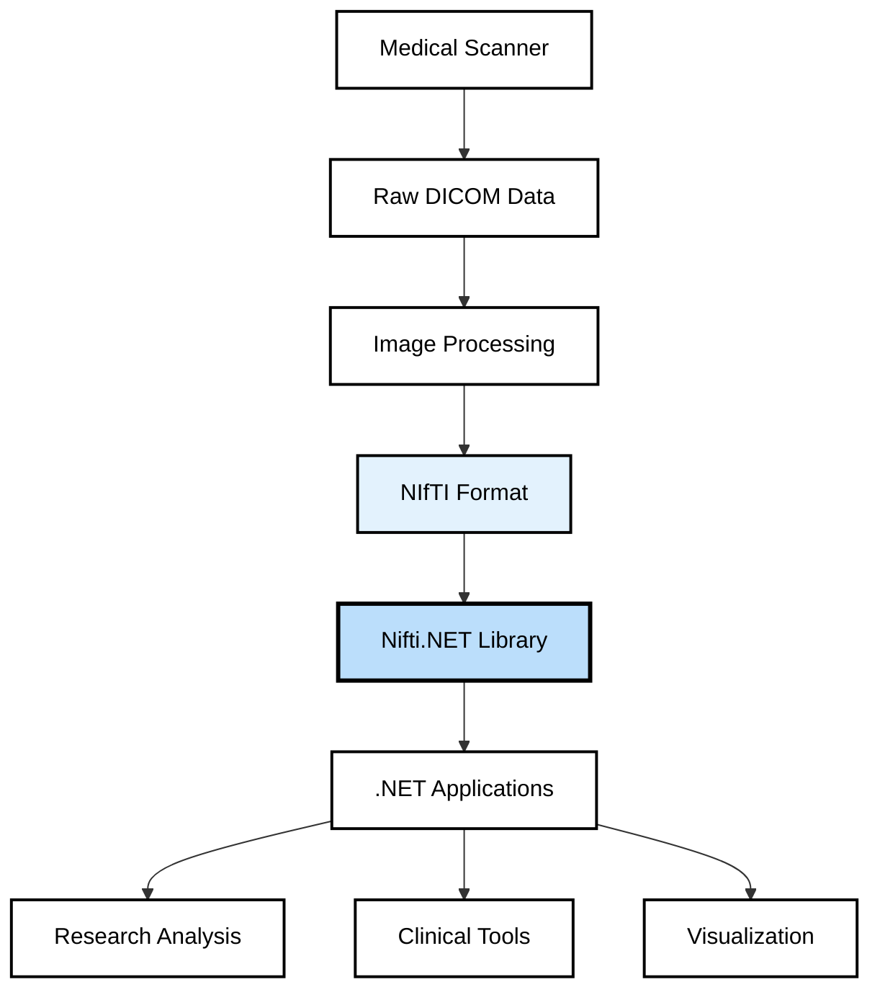
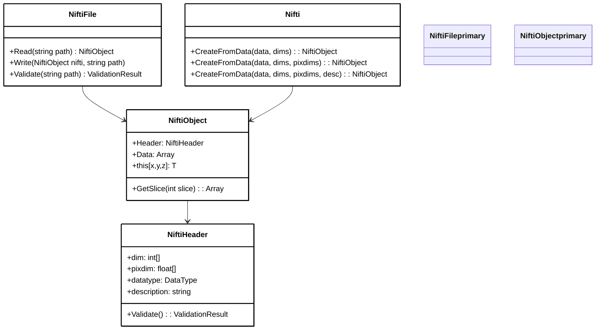
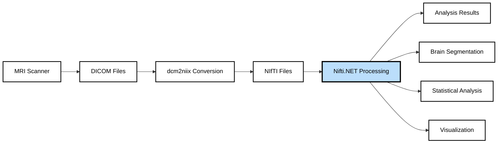

# Nifti.NET

[](https://www.nuget.org/packages/Nifti.NET/)
[](https://www.nuget.org/packages/Nifti.NET/)
[](https://github.com/plwp/Nifti.NET/stargazers)
[](https://github.com/plwp/Nifti.NET/blob/main/LICENSE)

A comprehensive .NET Standard library for reading, writing, and manipulating NIfTI (Neuroimaging Informatics Technology Initiative) medical imaging files with full NIfTI-1 specification compliance and validation.

> **Note:** If you're looking for the TensorFlow CNN platform, try [NiftyNet](https://niftynet.io/) instead.

## 🏥 Medical Imaging Focus

NIfTI format is the standard for storing neuroimaging data including MRI, fMRI, DTI, and other medical imaging modalities. This library enables .NET applications to seamlessly integrate with medical imaging workflows.



## 🚀 Key Features

- **Full NIfTI-1 Specification Compliance** - Complete support for NIfTI-1 format with validation
- **File Format Support** - Read/write `.nii`, `.hdr/.img`, and gzipped variants (`.nii.gz`, `.hdr.gz/.img.gz`)
- **Type-Safe API** - Strongly-typed access to neuroimaging data with compile-time safety
- **4D Time Series** - Full support for fMRI time series and multi-dimensional datasets  
- **Comprehensive Validation** - 75+ conformance tests ensuring specification compliance
- **Performance Optimized** - Efficient memory management for large medical imaging datasets
- **Cross-Platform** - .NET Standard 2.0 compatible (Windows, macOS, Linux)

## 📦 Installation

### NuGet Package Manager
```bash
Install-Package Nifti.NET
```

### .NET CLI
```bash
dotnet add package Nifti.NET
```

### Package Reference
```xml
<PackageReference Include="Nifti.NET" Version="1.2.0" />
```

## 🔧 Quick Start

### Basic File Operations

```csharp
using Nifti.NET;

// Read a NIfTI file
var nifti = NiftiFile.Read("brain_scan.nii");

// Access header information
Console.WriteLine($"Dimensions: {nifti.Header.dim[1]}×{nifti.Header.dim[2]}×{nifti.Header.dim[3]}");
Console.WriteLine($"Voxel size: {nifti.Header.pixdim[1]}×{nifti.Header.pixdim[2]}×{nifti.Header.pixdim[3]}mm");
Console.WriteLine($"Data type: {nifti.Header.datatype}");

// Access voxel data
float voxelValue = nifti[64, 64, 32]; // Voxel at coordinates (64,64,32)
```

## 📚 Advanced Usage

### Creating NIfTI from Data Arrays

```csharp
// Create a 3D brain volume
var volumeData = new float[256 * 256 * 180]; // Your imaging data
var dimensions = new int[] { 256, 256, 180 };
var pixelDimensions = new float[] { 1.0f, 1.0f, 1.0f }; // 1×1×1mm isotropic voxels

var nifti = Nifti.CreateFromData(volumeData, dimensions, pixelDimensions, "T1 Brain Volume");
NiftiFile.Write(nifti, "t1_brain.nii.gz");
```

### 4D fMRI Time Series Processing

```csharp
// Create 4D fMRI time series: 64×64×32 voxels × 200 time points
var timeSeriesData = new float[64 * 64 * 32 * 200];
var dimensions = new int[] { 64, 64, 32, 200 };
var pixelDimensions = new float[] { 3.0f, 3.0f, 3.0f, 2.0f }; // TR = 2 seconds

var fmriNifti = Nifti.CreateFromData(timeSeriesData, dimensions, pixelDimensions, "BOLD fMRI");

// Extract time series from specific voxel
var voxelTimeSeries = new float[200];
for (int t = 0; t < 200; t++)
{
    voxelTimeSeries[t] = fmriNifti[32, 32, 16, t]; // ROI voxel time series
}
```

### Type-Safe Operations

```csharp
// Create strongly-typed NIfTI objects
var floatNifti = Nifti.CreateFromData<float>(floatData, dimensions);
var shortNifti = Nifti.CreateFromData<short>(shortData, dimensions);
var byteNifti = Nifti.CreateFromData<byte>(byteData, dimensions);

// Type-safe data access
float[] voxelData = floatNifti.Data;
short maxValue = shortNifti.Data.Max();
```

## 🏗️ Architecture Overview



## 🔍 Data Type Support

| NIfTI Data Type | .NET Type | Description |
|----------------|-----------|-------------|
| `DT_UINT8` | `byte` | Unsigned 8-bit integer |
| `DT_INT16` | `short` | Signed 16-bit integer |
| `DT_INT32` | `int` | Signed 32-bit integer |
| `DT_FLOAT32` | `float` | 32-bit floating point |
| `DT_COMPLEX64` | `Complex` | 64-bit complex |
| `DT_FLOAT64` | `double` | 64-bit floating point |
| `DT_RGB24` | `RGB24` | RGB color triplet |

## 🧪 Validation & Quality Assurance

```csharp
// Comprehensive validation
var validator = new NiftiValidator();
var result = validator.ValidateFile("brain_scan.nii");

if (result.IsValid)
{
    Console.WriteLine("✅ File passes all NIfTI-1 conformance tests");
}
else
{
    foreach (var error in result.Errors)
    {
        Console.WriteLine($"❌ {error.Message}");
    }
}
```

### Validation Features
- **75+ Conformance Tests** - Comprehensive NIfTI-1 specification validation
- **Header Validation** - Ensures proper header structure and values
- **Data Integrity** - Validates data array consistency with header information
- **File Format** - Checks proper file structure and encoding

## 🎯 Common Use Cases

### Medical Research Pipeline



### Clinical Application Integration

```csharp
// Hospital PACS integration example
public class MedicalImagingService
{
    public async Task<ProcessingResult> ProcessBrainScan(string niftiPath)
    {
        var nifti = NiftiFile.Read(niftiPath);
        
        // Validate medical imaging data
        if (!ValidateMedicalImage(nifti))
            throw new InvalidDataException("Invalid medical image format");
            
        // Extract clinical metrics
        var volume = CalculateBrainVolume(nifti);
        var regions = SegmentBrainRegions(nifti);
        
        return new ProcessingResult
        {
            Volume = volume,
            Regions = regions,
            QualityScore = CalculateImageQuality(nifti)
        };
    }
}
```

## 📊 Performance & Benchmarks

- **Memory Efficient** - Lazy loading for large datasets
- **Fast I/O** - Optimized file reading/writing operations
- **Scalable** - Handles datasets from small volumes to large 4D time series

## 🤝 Contributing

We welcome contributions from the medical imaging and .NET communities!

1. **Fork** the repository
2. **Create** a feature branch (`git checkout -b feature/amazing-feature`)
3. **Add tests** for your changes
4. **Commit** your changes (`git commit -m 'Add amazing feature'`)
5. **Push** to the branch (`git push origin feature/amazing-feature`)
6. **Open** a Pull Request

## 📄 License

This project is licensed under the MIT License - see the [LICENSE](LICENSE) file for details.

## 🙏 Acknowledgments

- **NIfTI-1 Specification** - Neuroimaging Informatics Technology Initiative
- **Medical Imaging Community** - For feedback and real-world usage insights
- **Contributors** - Thank you to all who have contributed to this project

## 📈 Project Stats

- **13.8K+ NuGet Downloads** - Active usage across healthcare and research
- **12 GitHub Stars** - Community recognition  
- **8 Forks** - Active development contributions
- **MIT Licensed** - Open source and industry-friendly

---

*Built for the medical imaging community • Trusted by researchers worldwide • Production-ready*